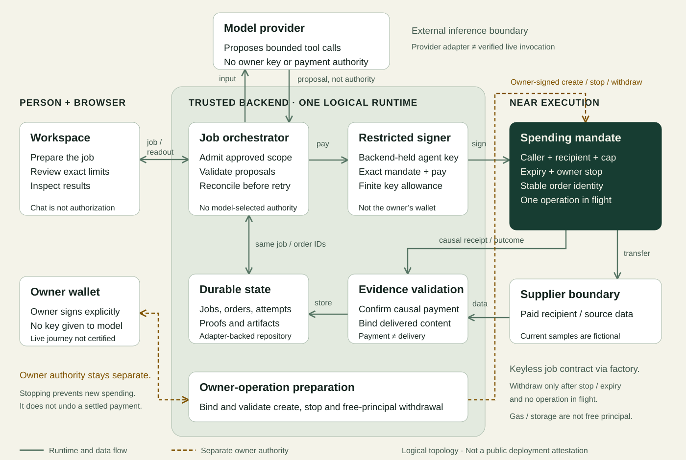

# Architecture and trust boundaries

[Back to Haldir](../README.md)

## Intelligence proposes. Authority stays bounded.

[](assets/haldir-authority-map.svg)

**Logical architecture, not a live-deployment attestation.** Backend boxes are modules and adapters, not independent microservices or custodians. The browser demo is a separate scripted simulation.

[Open the full-size SVG](assets/haldir-authority-map.svg) · [Download the standalone HTML](https://raw.githubusercontent.com/Loadout-gg/Haldir/main/docs/haldir-architecture.html)

Save the HTML and open it in a browser for expandable implementation notes and source references. It works offline; GitHub's file viewer does not run it as a webpage.

## A research agent is not a wallet owner

Haldir separates five concerns: the user's intent, explicit spending authorization, execution, evidence delivery and recovery. The model can propose work and summarize delivered material. It cannot grant itself a new recipient, extend an expired mandate or turn an unknown payment into a confirmed one.

```text
Person
  │ job + explicit spending approval
  ▼
Workspace ── authenticated requests ──► Backend
                                         │ immutable job/source bindings
                                         ▼
                                    Bounded runner
                                     │         │
                              model adapter   restricted payment adapter
                                               │
                                               ▼
                                     NEAR job mandate
                                     │ recipient/cap/expiry/stop checks
                                     ▼
                                  native transfer + callback
                                               │
                                               ▼
                                  payment evidence validation
                                               │
                                               ▼
                                  source delivery → report

Owner: stop new spending → reconcile pending operations → withdraw free principal
```

This is the implemented component design, not a diagram of a fully qualified public deployment. The scripted browser demo does not call this financial path.

## 1. A job-specific mandate on NEAR

The mandate contract (`qualification/mandate-contract/src/lib.rs`) stores the owner, agent, recipient allowlist, cap, expiry, spent/refunded principal, orders and in-flight operation. The factory (`qualification/mandate-factory/src/lib.rs`) creates job-specific contract accounts; its tests cover predecessor-bound ownership and the intended keyless creation batch.

### Payment boundary

`pay(order_id, recipient, amount)` checks:

- the caller is the configured agent;
- the order identifier is valid and has not already been used;
- spending has not been stopped and the deadline has not passed;
- the recipient is explicitly allowed;
- no other payment or withdrawal is in flight;
- the order limit and remaining principal permit the request.

The contract then records a pending order and requests a native transfer. A private callback resolves the outcome. Its serialization is intentionally conservative: **one operation in flight**, not a claim of simultaneous independent transfers. A duplicate request is rejected rather than treated as a new purchase.

### Stop and withdrawal

Only the owner can stop new spending. Stop does not cancel an already committed transfer. Withdrawal requires closure by stop or expiry and no in-flight operation; it transfers free principal to the owner. Requested withdrawal, successful transfer and confirmed recovered principal are separate facts.

Native token amounts use integer atomic units. The purchase principal is not the same as storage, gas or operating float. The demonstration's TEST units are separate fictional values.

## 2. Wallet and signing authority

Unsigned request preparation (`qualification/native-wallet/request.mjs`) binds the expected owner, network, factory, mandate and creation terms. Capability validation (`qualification/native-wallet/capability.mjs`) checks an exact restricted execution key, receiver, `pay` method and finite initial allowance. It rejects full-access keys, additional methods, unexpected keys and incomplete observations.

A wallet connection or authentication signature is not a spending authorization. The model must not receive the owner's access keys. Offline SDK tests establish request shape and validation behavior; they do not prove that a real owner has signed or that a live account has the expected keys.

## 3. Two distinct sources, one authorized job

The shared job contract (`src/shared/job-contract.mjs`) defines the two-source schema. It validates network, mandate, recipients, canonical integer amounts, expiry and distinct source/order identities. The combined quotes must fit the approved cap.

The runner (`src/agent/run-job.mjs`) consumes trusted admitted records rather than accepting browser or model assertions as approval. It preserves stable payment-operation identities, checks immutable bindings on resume and reconciles previous attempts before authorizing new work.

The first source and the second source must not reuse the same proof or masquerade as duplicate copies of one delivery. Payment success alone does not establish that content was delivered.

## 4. Evidence-linked reports, not supplier certification

Vendor fixtures (`src/vendor/fixture.mjs`) provide fictional company-record and background-research samples. Report findings bind excerpts to delivered artifacts, digests, source identities and purchase evidence. Model output is constrained and validated; it cannot invent a verified certification or add a financial tool.

In the Northwind example, the report can identify matching declared company details and a missing certification record, then recommend a concrete next check. It does **not** certify a real supplier or tell the user that signing is safe.

If inference is unavailable, retaining delivered excerpts is more honest than fabricating a complete conclusion. Cached report recovery must not silently repeat inference or payments.

## 5. Recovery and uncertain outcomes

A timeout can mean “outcome not yet known,” not “nothing happened.” Haldir keeps the same operation identity and checks trusted evidence. It must not create another charge merely because an acknowledgment was lost.

Owner-operation validation (`src/server/near-owner-operations.mjs`), receipt handling (`src/server/near-receipts.mjs`) and mandate-status parsing (`src/server/near-mandate-status.mjs`) provide distinct evidence boundaries. A top-level success message is not sufficient when the causal transfer or callback is missing, failed or inconsistent.

Unknown or stale balances remain unknown or stale. They must not appear as zero or be substituted with a convenient frontend calculation.

## What this does not claim

- Protection against every malicious document or every form of prompt injection.
- That an allowlisted recipient is honest or its information accurate.
- Production security audit, guaranteed fund recovery or lossless operation under all faults.
- Cross-chain settlement, private/TEE inference or live mainnet qualification.
- A real email integration merely because the scenario begins with an email available.
- That a public website, SDK unit test or local Sandbox transaction proves the entire hosted journey.

The useful security claim is narrower: **a document or model response is not spending authority, and the native mandate independently enforces its configured payment boundary.** Runtime deployment, account configuration and evidence validation must preserve that boundary.

## Verification map

| Question | Source / tests |
| --- | --- |
| Does the contract reject unauthorized spending and protect closure? | `qualification/mandate-contract/tests/mandate.rs`; `qualification/mandate.sandbox.test.mjs` |
| Is factory creation bound to the intended owner and contract? | `qualification/mandate-factory/src/lib.rs`; `qualification/mandate-factory.sandbox.test.mjs` |
| Can a signing request or key grant more than intended? | `qualification/native-wallet/*.test.mjs` |
| Can altered source bindings or reused proof cross job boundaries? | `tests/server/two-source-contract.test.mjs` |
| What happens after response loss, stop or expiry between sources? | `tests/agent/two-source-run-job.test.mjs` |
| What constitutes confirmed owner stop/withdrawal? | `tests/server/near-owner-operations.test.mjs`; `tests/server/owner-preparation-retry.test.mjs` |

Use [the validation guide](VALIDATION.md) to run a bounded proof and interpret its environment. Test source is an invitation to verify, not a substitute for executed evidence.
